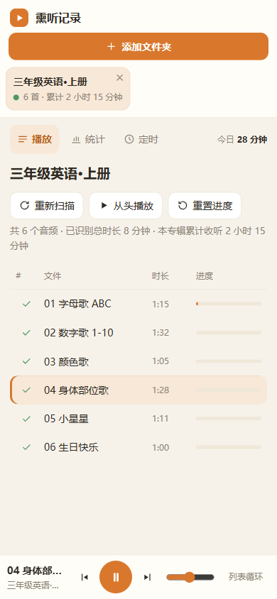
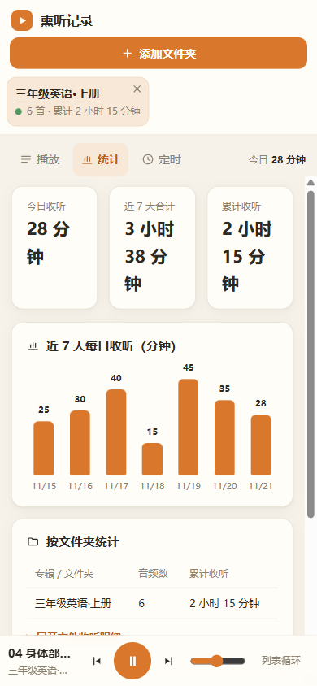

<p align="center">
  
</p>

<h1 align="center">熏听记录</h1>

<p align="center">
  本地音频熏听播放与收听时长记录 · 文件夹导入 · 顺序播放 · 定时收听 · 断点续播
</p>

<p align="center">
  <a href="https://zhou101818.github.io/xunting-app/"></a>
  <a href="https://github.com/zhou101818/xunting-app/releases/latest"></a>
</p>

<br>

<p align="center">
  &nbsp;&nbsp;&nbsp;&nbsp;
  
</p>

## 是什么

给孩子磨耳朵、熏听英语用的本地音频播放器。选中手机上的一个文件夹，自动扫描里面的音频，像专辑一样管理；顺序播放、定时播放、断点续播，并记录每个文件夹听到的时长。

- **数据全部在本地**：音频留在手机里，收听统计存在设备上，不上传任何数据
- **两种形态**：安卓 APK（原生文件夹导入）与 网页 PWA（可添加到主屏幕），同一个应用

## 功能

| 功能 | 说明 |
|---|---|
| 文件夹导入 | 安卓端选择整个文件夹，递归扫描子目录中的所有音频并复制进应用 |
| 顺序播放 | 文件名自然排序（1、2、10 不乱序），播完自动下一首 |
| 循环模式 | 列表循环 / 单曲循环 / 播完即停，支持 0.8x–2x 倍速 |
| 定时收听 | 每日定时开始、单次时长上限（到点自动暂停）、每日定时停止 |
| 时长统计 | 按专辑 / 单个文件 / 按天三个维度累计真实收听时长，近 7 天柱状图 |
| 断点续播 | 每个文件记住播放位置，听完自动打勾，可一键重置进度 |
| 锁屏控制 | 播放中在通知栏和锁屏界面显示曲名并支持控制 |
| 数据导出 | 统计与进度可导出 JSON 备份 |

## 快速开始

### 方式一：安卓 APK（推荐）

1. 前往 [Releases](https://github.com/zhou101818/xunting-app/releases/latest) 下载最新 `xunting-*-debug.apk`
2. 手机安装时允许「未知来源应用」一次即可
3. 打开应用 → 点「导入文件夹」→ 选择存放音频的文件夹 → 确认导入

> 后续版本可直接覆盖安装，无需卸载。

### 方式二：网页版 / 添加到主屏幕

访问 **https://zhou101818.github.io/xunting-app/**

手机 Chrome 打开后，菜单中选择「添加到主屏幕」，即为独立图标、全屏运行，支持离线缓存。网页版通过浏览器的目录授权直接读取文件夹（不复制文件），数据同样只存本机。

## 使用建议

- 定时播放需要应用页面保持存活（切后台即可），这是浏览器与系统的共同限制；要「手机没开应用也准点自动响」，需额外的原生闹钟开发
- 首次使用请手动播放一次，以解除系统的自动播放限制
- 收听时长按真实时间累计，与倍速无关
- 网页版与 APK 的数据各自独立，互不影响

## 技术栈

- 前端：原生 HTML / CSS / JavaScript 单文件应用（`docs/index.html`），无框架
- 安卓：Capacitor 7 壳 + 自定义原生插件（`FolderImportPlugin`，基于 SAF 的文件夹导入与按需读取）
- 构建：GitHub Actions 云端构建 APK（`android/` 工程入仓，签名密钥固定保证覆盖升级）
- 部署：GitHub Pages 托管 PWA（`docs/` 目录），Service Worker 离线缓存

## 项目结构

```
├─ docs/                     # 网页应用（GitHub Pages 源）
│  ├─ index.html             # 应用全部逻辑（单文件）
│  ├─ manifest.json          # PWA 清单
│  ├─ sw.js                  # Service Worker 离线缓存
│  └─ icon-*.png             # 应用图标
├─ android/                  # Capacitor 安卓工程
│  └─ app/src/main/java/com/zhou101818/xunting/
│     ├─ MainActivity.java
│     └─ FolderImportPlugin.java   # 原生文件夹导入插件
├─ .github/workflows/build-apk.yml # 云端构建 APK 工作流
├─ capacitor.config.json
└─ package.json
```

## 许可

个人自用项目，未附带开源协议。代码与设计可参考学习，不提供任何形式的担保。

> AI生成
